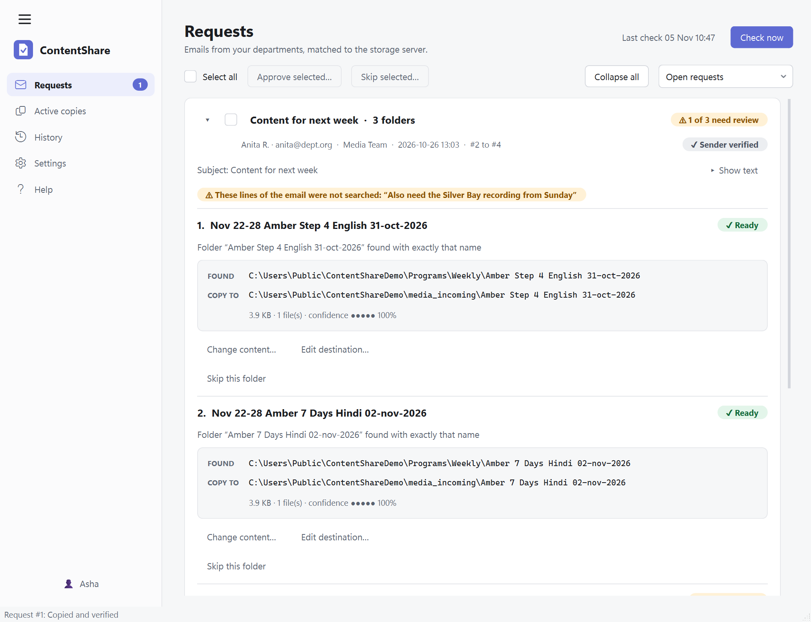

# ContentShare: user guide

ContentShare reads the content requests that departments email you, finds the program on the
storage server, copies it to that department's folder **and checks the copy is perfect**, then
replies in the same email thread.

**Nothing is copied and nothing is sent until you click.** The screenshots below use made-up
sample requests.

## 1. Install

1. Run `ContentShare-Setup-<version>.exe`. It installs for you only; it does not ask for
   administrator rights.
2. Windows may show a blue "Windows protected your PC" box if the installer is not signed.
   Choose **More info → Run anyway** only if you got the installer from your own team.
3. Start **ContentShare** from the Start menu.

To remove it: Windows Settings → Apps → ContentShare → Uninstall. Your settings and history stay
in `%APPDATA%\ContentShare` unless you delete that folder yourself.

## 2. First start

A short setup asks for **where the programs are stored** (you can add several folders, and edit or
remove them with the **Edit** and **Remove** buttons) and **your first department** (its
email addresses and the folder its copies go to). It starts in **dry-run mode**, which means
approving a request only *checks* what would be copied. Nothing is copied or sent until you
turn dry-run off in Settings → General.

## 3. Connect Gmail (once)

Follow [GMAIL_SETUP.md](GMAIL_SETUP.md) to create the Google sign-in file (about 15 minutes).
Then Settings → Gmail → choose the file → **Connect Gmail**. Google's own sign-in page opens;
ContentShare never sees your password. To stop, use **Disconnect**.

## 4. Requests

Each request line is a card:

| You see | It means |
|---|---|
| **✓ Ready** | One clear match was found. |
| **⚠ Needs review** | Several matches, or something differs (date, language, part). Pick one with **Use this**, or **Search manually**. |
| **Sender not verified** | Gmail could not confirm who sent it. You must tick one more box before copying. |

To copy: check the folder it will copy **from** and **to**, tick **Confirm copy**, click
**Approve**. **Skip** hides a request; **Reject** can send the sender a short "cannot share"
reply you can edit first.

Pressing **Check now** reads new mail. Every day at the time set in Settings the app does this
by itself too. That only adds cards; **it never copies or sends**.

## 5. Active copies

Shows progress, speed and time left. **Pause**, **Resume** and **Cancel** work at any time.
When a copy finishes, every file has been read back from the destination and compared with the
original. If a file does not match it is copied again; if it still fails the request shows
**✖ Failed** with the reason and a **Retry** button, and no "shared" reply can be sent.

If you quit or the PC restarts mid-copy, the copy continues from where it stopped the next time
ContentShare starts.

## 6. Replying

After **✓✓ Verified** the reply is ready: **Send reply…** shows the message and lets you edit it
before sending. If **Send the reply automatically** was ticked on the card, it is sent for you
as soon as the copy is verified. Replies go only to the person who asked, in their thread.

## 7. History

Every request, with a step-by-step record of what happened. **Export CSV** saves it for Excel.

## 8. The automatic check, tray and pop-ups

* How often mail is checked by itself (once a day at a set time, or every 15 or 30 minutes, every
  hour, or every 2, 3, 6 or 12 hours), **Start ContentShare when I sign in to Windows**, and the
  tray options are in Settings → General. A check only adds request cards.
* Closing the window leaves ContentShare running next to the clock (tray). **Right-click the
  icon → Quit** to really close it. An amber dot on the icon means requests are waiting.
* Pop-ups say things like "3 new requests" or "Request #7: copy verified". They never show
  email subjects, names or folders, so they are safe on a locked screen.
* If the PC was off at check time, ContentShare checks when it is next on.

## 8a. Help and updates

* **Help** in the left-hand list explains how to connect Gmail step by step, how to use each
  screen, and what every setting does. It is part of the program and works offline.
* When ContentShare starts it checks whether a newer version exists. If so, a box appears at the
  **bottom left** of the window with **Download**. When the download has finished and been checked
  against its published checksum, the box shows **Update** and **Cancel**. Nothing is installed
  until you press **Update**, and the update waits while copies are running.
* Turn the start-up check off, or check right now, in Settings → General.

## 9. Backup and moving to another PC

Your settings are one file: `%APPDATA%\ContentShare\config.yaml` (a copy of the previous version
is kept as `config.yaml.bak`). History and the file index are in `contentshare.db` in the same
folder. To move to another PC: install, close the app, copy those files into the same folder,
then **connect Gmail again** (the sign-in is deliberately not copied: it lives in Windows
Credential Manager for your user only).

## 10. Problems

| Problem | What to do |
|---|---|
| "Gmail is not connected" bar | Settings → Gmail → Connect. If it keeps coming back every week, see the *Internal* app note in GMAIL_SETUP.md. |
| A request is **Needs review** but you think it is obvious | Open the matches. You can lower *Mark Ready when at least* in Settings → Matching, but check real matches first. |
| A program is not found | Settings → Index → **Refresh index now** (the server is scanned about once a day). |
| Copy **Failed** repeatedly | Read the reason. If files keep failing verification, test the PC's memory, the cable and the server, because the checksum is catching real corruption. |
| No pop-ups | Windows Settings → System → Notifications: make sure ContentShare is on and Focus is off. |
| Something else | The log is `%APPDATA%\ContentShare\logs\contentshare.log` (it never contains passwords or email text). |

To check the installation is complete, open a command prompt in the program folder and run
`ContentShare.exe --selftest report.json`. Open `report.json`: it says `"ok": true` when every part
of the program works, and names the part that does not otherwise.
