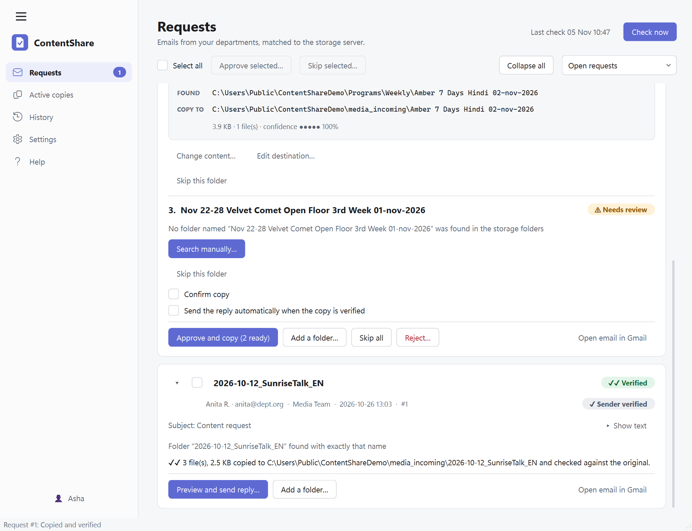
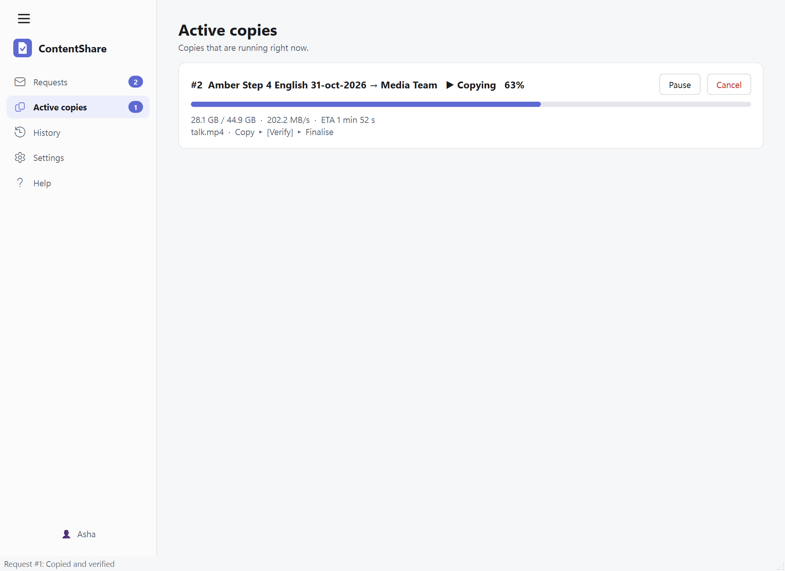
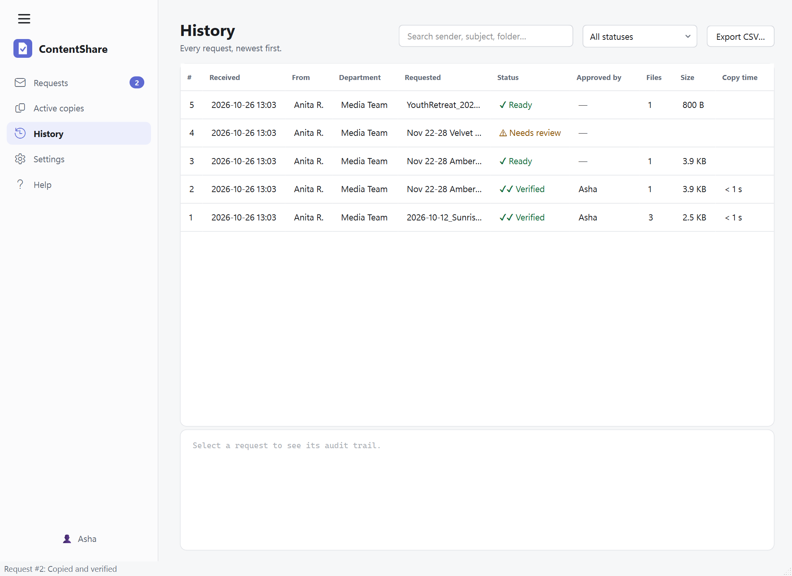
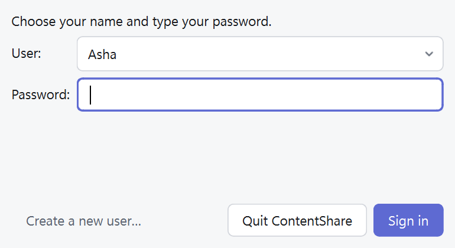
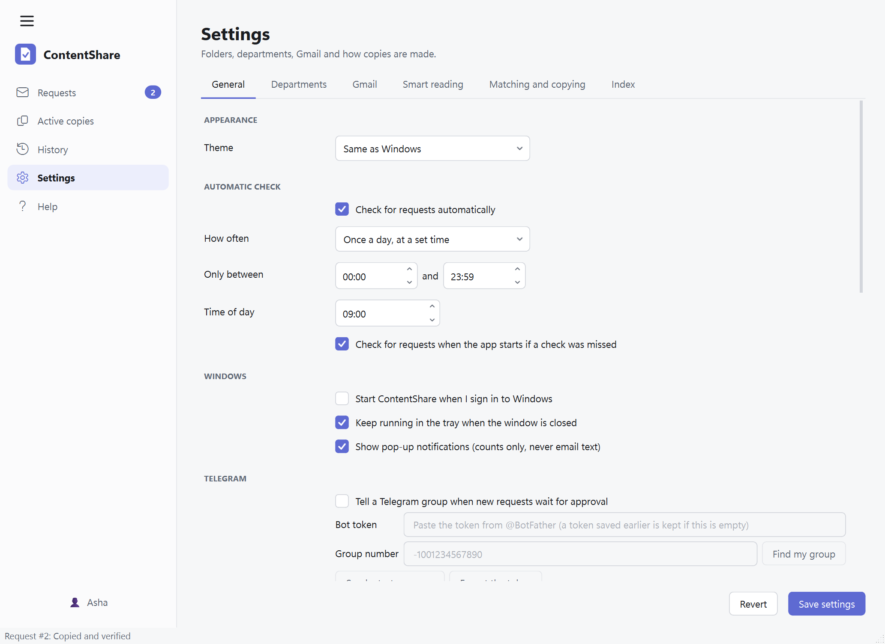
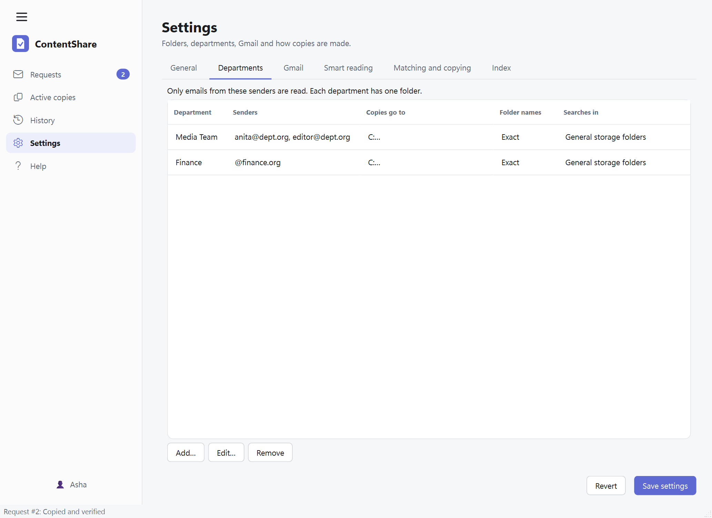
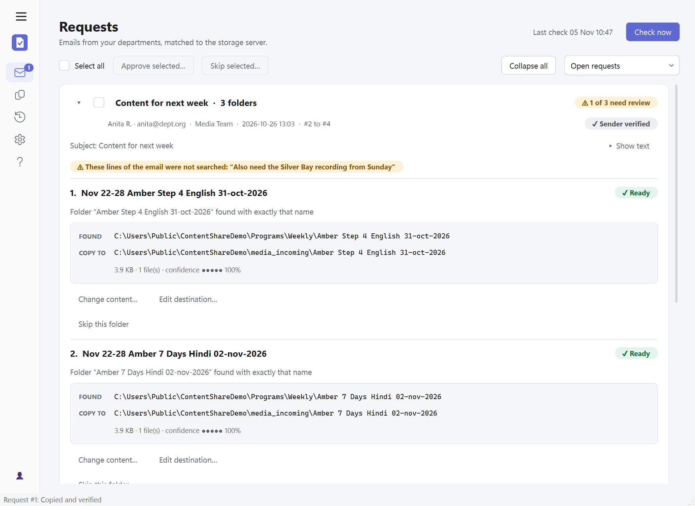

# ContentShare: user guide

ContentShare helps you answer content requests.

1. A department emails you the name of a program.
2. ContentShare finds that program on the storage server.
3. **You** check it and click **Approve**.
4. ContentShare copies it to the department's folder, checks that the copy is perfect, and
   replies in the same email.

> **Nothing is copied and nothing is sent until you click.** The pictures in this guide use
> made-up sample requests.

**On this page:** [Install](#1-install) · [First start](#2-first-start) ·
[Connect Gmail](#3-connect-gmail-once) · [Requests](#4-requests) ·
[Copying](#5-copying) · [Replying](#6-replying) · [History](#7-history) ·
[Settings](#8-settings) · [Updates and Help](#9-updates-and-help) ·
[Moving to another PC](#10-moving-to-another-pc) · [Problems](#11-problems)

---

## 1. Install

1. Run `ContentShare-Setup-<version>.exe`. It installs for you only and does not ask for an
   administrator password.
2. If Windows shows a blue "Windows protected your PC" box, choose **More info → Run anyway**,
   but only if the installer came from your own team.
3. Start **ContentShare** from the Start menu.

To remove it: Windows Settings → Apps → ContentShare → Uninstall. Your settings and history stay in
`%APPDATA%\ContentShare` unless you delete that folder.

## 2. First start

A short setup asks two things:

* **Where the programs are stored.** Add one or more folders (a network path such as
  `\\storage01\Programs` is fine).
* **Your first department.** Its email addresses, and the folder its copies go to.

It starts in **dry-run mode**: approving a request only *checks* what would be copied. Nothing is
copied or sent until you turn dry-run off in **Settings → General**.

## 3. Connect Gmail (once)

1. Follow [GMAIL_SETUP.md](GMAIL_SETUP.md) to get the Google sign-in file (about 15 minutes).
2. **Settings → Gmail** → choose the file → **Connect Gmail**.
3. Google's own page opens. ContentShare never sees your password.

To stop, press **Disconnect**.

## 4. Requests

Press **Check now** to read new mail. (ContentShare also checks by itself, see
[Settings](#8-settings). A check only adds cards. It never copies or sends.)

**One email is one card.** If the email lists several folders, the card has a numbered section for
each one.

Each folder shows one of these:

| You see | It means | What to do |
|---|---|---|
| ✓ **Ready** | The folder was found. | Nothing. It is ready to approve. |
| ⚠ **Needs review** | Not found, found in several places, or something does not match. | Read the line under the name. Pick a path with **Use this**, or press **Search manually…**. |
| **Sender NOT verified** | Gmail could not confirm who sent the email. | Check the request carefully. |

### How a name is found

ContentShare looks for a folder with **exactly the name in the email**. A date or date range
written before the name (for example `Nov 22-28`) is ignored. A date inside the name, such as
`… English 31-oct-2026`, is kept. If no folder has that name it also looks for a file with that
name. Nothing is guessed.

If the storage folders were last read a while ago, ContentShare reads them again once before it
says "not found", so a folder made this morning is found.

### Nothing is skipped quietly

* A listed name with **no folder on the server** appears as **Needs review**, with the words
  *No folder named … was found*. Press **Search manually…** to find it yourself.
* Any other line of the email that did **not** become a request is listed in a yellow note at the
  top of the card: **These lines of the email were not searched**. Read it, and compare with the
  email if something looks missing. Greetings, thanks and the "On … wrote" line of a quoted reply
  are not listed.
* To add one of those lines, or any other folder, to the same request, press **Add a folder…** on
  the card. Click a listed line or type the name, then choose the folder on the server. It becomes
  one more numbered section of the same card, and the same single reply covers it. The button is
  on every card, also for a request that was already copied: the new folder is copied and
  checked on its own.
* **Show text** shows the start of the email on the card.

### Copy a request

1. Check the folder it will copy **from** and **to** (shown as *FOUND* and *COPY TO*).
2. Tick **Confirm copy**.
3. Press **Approve and copy**. It copies every folder that is Ready.

Other buttons: **Skip this folder** (leave one out), **Skip all**, and **Reject…** (can send the
person a short "cannot share" reply that you can edit first). **Open email in Gmail** opens the
original.

> When the content is a **single file**, only that file is copied into the department's folder,
> without an extra folder around it.

To see more requests at once, press **Collapse all**, or the small arrow on one card.

## 5. Copying

**Active copies** shows each copy's progress, speed and time left.

* **Pause** and **Resume** work at any time.
* **Cancel** asks first ("Stop copying …?"). Files already checked are kept and the copy can be
  retried later. Nothing on the server is ever deleted.

When a copy finishes, every file has been read back from the destination and compared with the
original. If a file does not match, it is copied again. If it still fails, the request shows
**✖ Failed** with the reason and a **Retry** button, and no "shared" reply can be sent.

If you quit or the PC restarts in the middle of a copy, it continues from where it stopped the
next time ContentShare starts.

## 6. Replying

After **✓✓ Verified**, press **Preview and send reply…**. It shows the message and lets you edit it
before sending. If **Send the reply automatically** was ticked on the card, the reply is sent for
you as soon as the copy is verified.

One email gets **one reply**, naming every folder that was copied and checked. It goes only to the
person who asked, in their thread.

## 7. History

Every request, newest first. Click one to see a step-by-step record of what happened. Use the
search box and the status filter to find a request. **Export CSV** saves the list for Excel. The
**Approved by** column shows the name of the person who approved it (a dash for older requests),
and **Copy time** shows how long each copy took.

### Signing in

Every time ContentShare opens it asks you to sign in, so the History can show who approved what.

* **Choose your name** (the last person is already selected) and **type your password**.
* **New here?** Press **Create a new user…**, type a name and a password twice, and you are in.
  The password can be anything, even one letter or number; it only has to be typed the same way
  next time.
* Press the name button in the menu on the left to sign in as someone else without closing the
  app. **Quit ContentShare** in the box closes the app instead.
* Forgot a password? There is no recovery: create a new user. The old name stays in the History.

This tells people apart. It is not strong protection: anyone who can open the program's files on
this PC could get around it.

## 8. Settings

Change things, then press **Save settings** (bottom right). **Revert** undoes what you typed.

**General**

* **Theme:** same as Windows, light or dark.
* **Check for requests automatically**, and **How often:** once a day at a set time, or every 15
  minutes up to every 12 hours.
* **Start ContentShare when I sign in to Windows** and **Keep running in the tray when the window
  is closed.** Closing the window leaves ContentShare next to the clock. Right-click the icon →
  **Quit** to really close it.
* **Show pop-up notifications.** They say things like "3 new requests". They never show email
  subjects, names or folders, so they are safe on a locked screen.
* **Dry-run mode:** approving only checks. A bar across the window reminds you while it is on.
* **Storage folders:** where programs are searched (add, edit or remove them).

**Telegram alerts (optional).** So you hear about new requests without keeping the window open:

1. In Telegram, open **@BotFather**, send `/newbot`, and copy the **token**.
2. Add the bot to your group and write any message in it.
3. In Settings → General → Telegram: tick the switch, paste the token, press **Find my group**,
   then **Send a test message**, then **Save settings**.

The message only gives counts, for example *"3 new requests waiting for approval (2 ready, 1 need
a look)"*. Approving always stays with you. The token is kept in Windows Credential Manager.

**Departments.** Each department is a set of sender emails, **one folder** its copies go to, and
(if you want) its own folders to search. Only emails from these senders are read. Press **Add…**,
**Edit…** or **Remove**.

In a department you can tick **The emails give exact folder names**. Leave it off for emails that
describe programs in free words (you then get the closest matches to choose from).

**Gmail, Matching and copying, Index.** Defaults are good for most people. **Index → Refresh
index now** reads the storage server again.

Every setting is explained in **Help → Settings explained**.

## 9. Updates and Help

* **Fold the menu** with the **☰** icon at the top of the menu. It leaves only icons. Press **☰** again to open it. The choice is remembered.
* **Help** (in the menu) explains how to connect Gmail, how to use each screen, and what every
  setting does. It is part of the program and works offline.
* When ContentShare starts it looks for a newer version. If one exists, a box appears at the
  **bottom left** with **Download**. When the download has been checked, the box shows **Update**.
  Nothing is installed until you press it, and the update waits while copies are running.

## 10. Moving to another PC

Your settings are one file, `%APPDATA%\ContentShare\config.yaml`. History and the file index are in
`contentshare.db` in the same folder.

1. Install ContentShare on the new PC and close it.
2. Copy those two files into the same folder on the new PC.
3. Start it and **connect Gmail again**. (The sign-in is deliberately not copied.)

## 11. Problems

| Problem | What to do |
|---|---|
| "Gmail is not connected" bar | Settings → Gmail → **Connect Gmail**. If it keeps coming back every week, see the *Internal* app note in [GMAIL_SETUP.md](GMAIL_SETUP.md). |
| A folder says **No folder named … was found** | Check the spelling against the server. Press **Search manually…** to pick it. A folder made very recently is looked for automatically. You can also press Settings → Index → **Refresh index now**. |
| A request is **Needs review** but looks obvious | Choose it with **Use this**. |
| An email line was **not searched** | Read the yellow note on the card, then add that item yourself or ask the sender. |
| A copy shows **Failed** again and again | Read the reason. If files keep failing the check, test the PC's memory, the cable and the server. The check is catching real damage. |
| No pop-ups | Windows Settings → System → Notifications: make sure ContentShare is on and Focus is off. |
| No Telegram message | Settings → General → Telegram → **Send a test message**. The reply says what is wrong. |
| Something else | The log is `%APPDATA%\ContentShare\logs\contentshare.log`. It never contains passwords or email text. |

To check the installation is complete, open a command prompt in the program folder and run
`ContentShare.exe --selftest report.json`. The report says `"ok": true` when every part works.

---

*The pictures are made by `python tools/make_screenshots.py` from invented data, so they can be
refreshed after the look of the program changes.*
